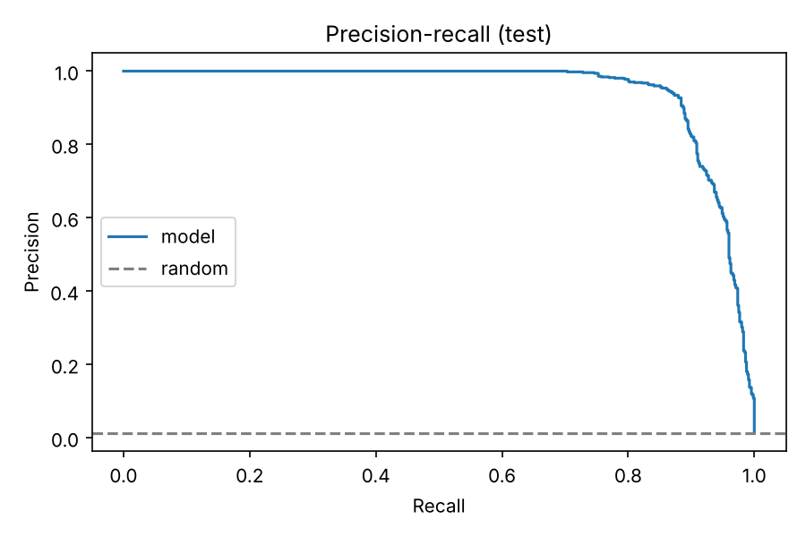
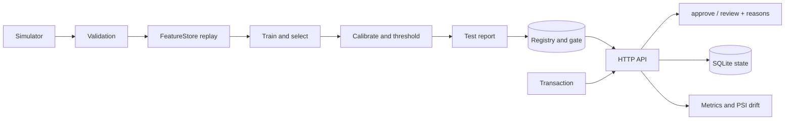

# FraudShield: Production-Style Real-Time Fraud Scoring Service

An end-to-end ML system that scores card transactions before approval: data simulation,
leakage-safe features, model selection (including LightGBM), probability calibration,
cost-based decisions, a model registry, an HTTP API, SQLite-backed customer state
persistence, a business-cost threshold tuner, and drift monitoring.

> **Data disclaimer:** all data is **synthetic**, produced by `fraudshield.data.simulate`.
> Evaluation metrics come from a synthetic transaction simulator and show that the pipeline
> works correctly. They do not represent performance on real card traffic. This is a
> portfolio project demonstrating production ML engineering practices.

## Results (held-out final 20% of time, default config)

| Metric | Value |
|---|---|
| PR-AUC | **0.947** (95% CI 0.928 to 0.962, day-level bootstrap) |
| PR-AUC of hand-written rules | 0.473 |
| ROC-AUC | 0.998 |
| Recall at chosen threshold | 94.9% |
| Precision at chosen threshold | 61.5% |
| Alerts | 998 of 50,871 transactions (2.0%) |
| Modelled cost reduction vs. no screening | 85.6% |

Recall by fraud pattern: card testing 98.7%, stolen card 96.9%, account takeover **74.7%**
(the hardest, as it stays in the home country and often looks like normal spending).

Model selection (selection split PR-AUC): logistic regression 0.744, random forest 0.892,
**shallow gradient boosting 0.919**, deep gradient boosting 0.915.
When LightGBM is installed, it is included as an additional candidate.



## Architecture



## Quick start

Needs Python ≥3.11 (tested on 3.12 and 3.13). Run from the project root.

```bash
python -m venv .venv && source .venv/bin/activate   # Windows: .venv\Scripts\activate
pip install -r requirements-dev.txt
pip install --no-deps -e .

fraudshield simulate     # writes data/transactions.csv.gz
fraudshield train        # trains, evaluates, registers and promotes a model
pytest -q
fraudshield serve        # http://127.0.0.1:8000
python scripts/demo.py   # in a second terminal
```

### With persistent state (SQLite)

```bash
fraudshield serve --state-db state/customers.db
```

Customer history is now written to SQLite and survives process restarts.

### Threshold tuning

```bash
fraudshield tune-threshold                          # uses default config
fraudshield tune-threshold --review-cost 10         # more expensive reviews
fraudshield tune-threshold --missed-fraud-multiplier 2.0  # add chargeback fees
```

### Optional: LightGBM candidate

```bash
pip install lightgbm
fraudshield train  # LightGBM is now included in model comparison
```

Docker (the model is trained during the image build):

```bash
export FRAUDSHIELD_API_KEY=choose-a-long-random-value
docker compose up --build
```

## API

| Method and path | Purpose |
|---|---|
| `GET /health`, `GET /ready` | Liveness and loaded model version |
| `POST /v1/predict` | Score one transaction |
| `GET /v1/drift` | PSI of recent traffic (needs 500+ scored requests) |
| `GET /metrics` | Prometheus text format |

Set `FRAUDSHIELD_API_KEY` to require the `x-api-key` header on all but the health routes.
Without it the API is open, so keep it on localhost.

```bash
curl -s http://127.0.0.1:8000/v1/predict -d '{
  "transaction_id": "abc-1", "customer_id": "C00001",
  "timestamp": "2026-07-01T10:00:00Z", "amount": 950,
  "merchant_id": "M-gift_cards-007", "category": "gift_cards",
  "channel": "online", "country": "SG", "device_id": "new-device"}'
```

The response holds `fraud_probability`, `decision`, `threshold`, `reasons`, `model_version`
and `duplicate`. Errors: 401 bad key, 409 out-of-order or reused ID, 413 too large,
422 invalid input.

## Design decisions

- **One feature implementation** for training and serving; a test checks parity.
- **No leakage:** features use only earlier events, splits are chronological, and the test
  split takes no part in selection, calibration or thresholding.
- **PR-AUC over accuracy:** with about 1% fraud, approving everything is about 99% accurate.
- **Cost-based threshold:** minimises review cost plus the value of missed fraud, with a
  configurable precision-recall tuner for different business cost assumptions.
- **SQLite persistence:** customer state survives restarts without external infrastructure.
- **LightGBM comparison:** when installed, LightGBM joins the candidate pool and its
  performance is logged alongside scikit-learn models.
- **Safe releases:** quality gate, atomic champion switch, checksum and version check.

More in [docs/ARCHITECTURE.md](docs/ARCHITECTURE.md) and [docs/MODEL_CARD.md](docs/MODEL_CARD.md).

## Performance

Measured on a 2-vCPU cloud container, one server process, load generator on the same
machine, 1,000 requests per run, cold-start customers, mostly approvals.

| Concurrency | Requests/s | p50 | p95 | p99 |
|---|---|---|---|---|
| 1 | 130 | 7 ms | 10 ms | 14 ms |
| 4 | 115 | 34 ms | 50 ms | 59 ms |
| 16 | 107 | 149 ms | 182 ms | 195 ms |

Reproduce with `python scripts/load_test.py --concurrency 4`. Scoring is serialised by a
lock, so more concurrency adds queueing, not throughput.

## Monitoring

```bash
fraudshield monitor --data data/transactions.csv.gz --since 2026-06-01
```

Exit code 2 means PSI reached 0.25.

## CI/CD

The GitHub Actions pipeline (`make lint` → `make test` → `docker build`) runs on every
push and PR against `main`, testing on Python 3.12 and 3.13. See the green checkmark on
the latest commit.

## Known limitations

- Scoring is serialised: one worker only, throughput does not scale with concurrency.
- The duplicate cache holds the last 10,000 requests and is not persisted.
- All transactions update history, including suspected fraud.
- Labels are assumed available immediately; real chargebacks arrive weeks later.
- No TLS or rate limiting: put the API behind a gateway.
- Reason codes are one-feature sensitivity checks, not SHAP values.

## Roadmap

1. Evaluate on a public real-world fraud dataset (needs its own feature adapter).
2. Redis-backed feature state for multi-worker deployments.
3. Label-delay-aware splits and scheduled retraining.
4. Experiment tracking and SHAP explanations.

## Project layout

```
src/fraudshield/   config, schema, data, features, models, serving, monitoring, cli
tests/             data, feature, model, API, SQLite and threshold tuner tests
configs/           YAML configuration
scripts/           demo and load test
reports/           metrics and plots from the reference run
docs/              architecture, model card, interview guide
```
